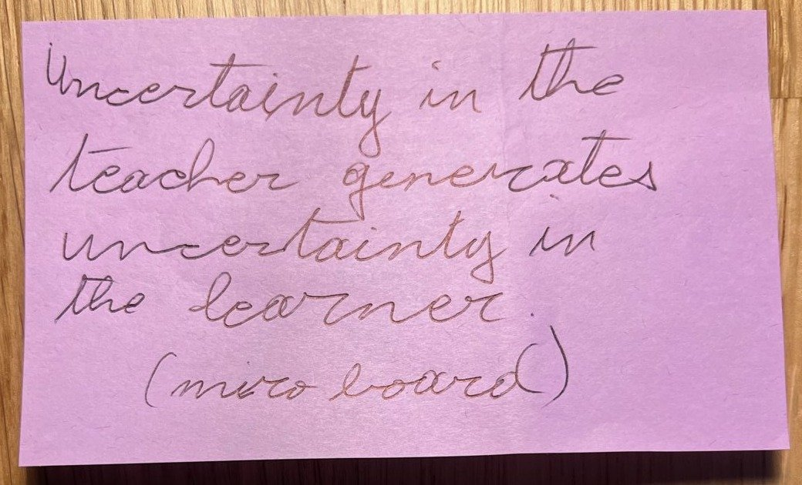
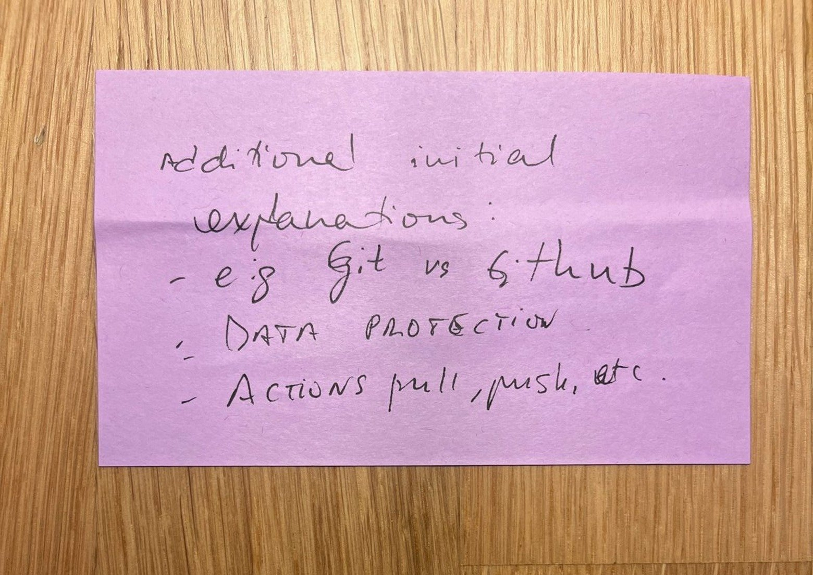
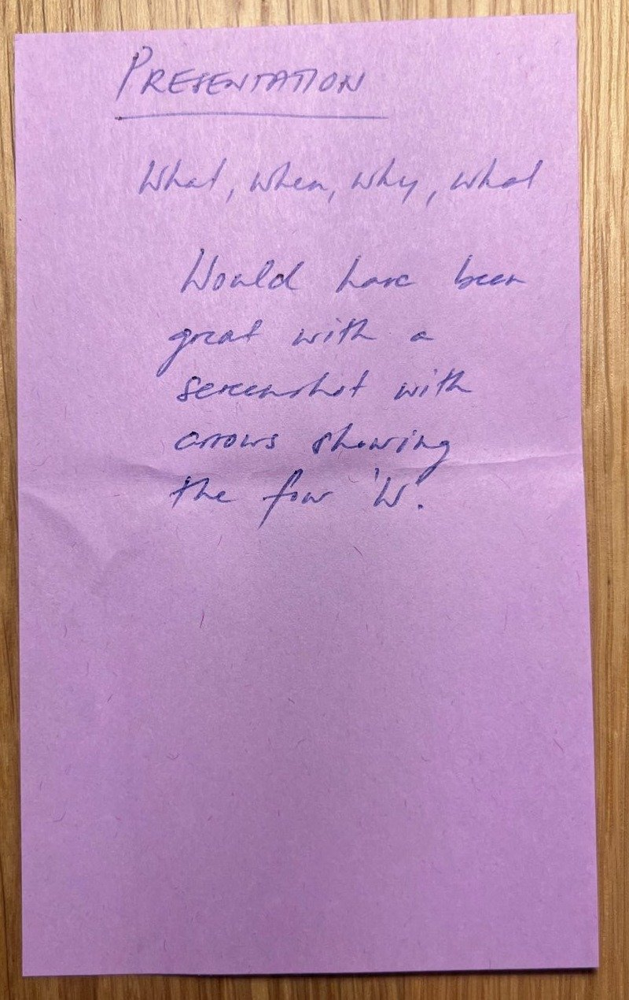
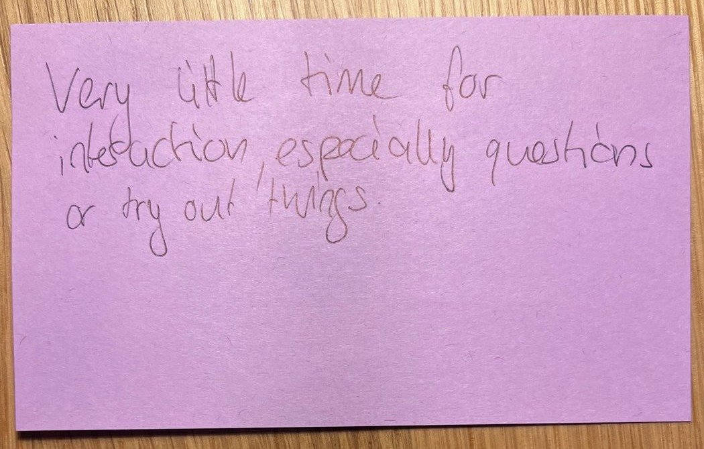
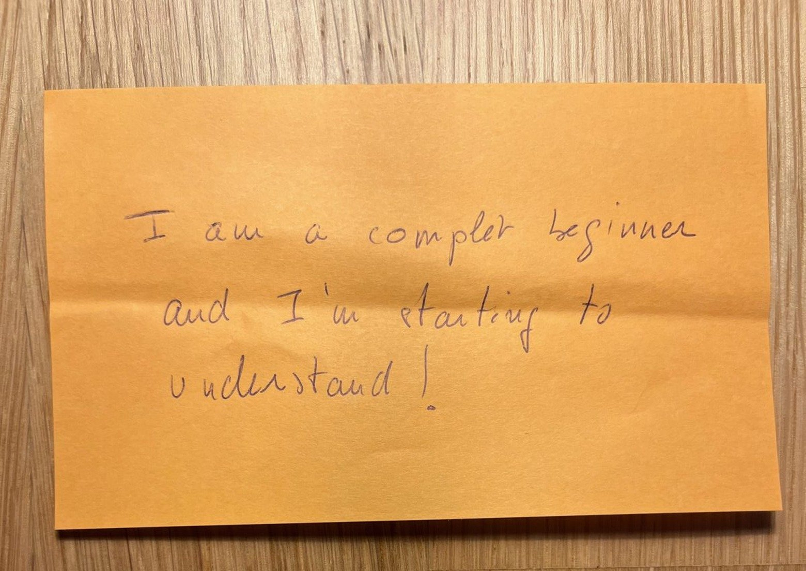
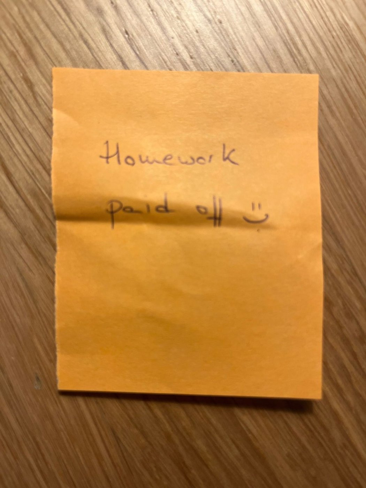

```{r}
#| label: setup
library(ggplot2)
library(dplyr)
library(readr)

feedback <- read_csv(here::here("data", "feedback_items.csv"), show_col_types = FALSE)
survey <- read_csv(here::here("data", "survey_counts.csv"), show_col_types = FALSE)

paper <- "#F6F1E7"
ink <- "#1A1714"
note_colours <- c("went well" = "#F2A04A", "can be improved" = "#C9A0DC")

theme_talk <- theme_minimal(base_size = 30) +
  theme(
    plot.background = element_rect(fill = paper, colour = NA),
    panel.background = element_rect(fill = paper, colour = NA),
    panel.grid = element_blank(),
    axis.title = element_blank(),
    axis.text = element_text(colour = ink),
    axis.text.x = element_blank(),
    legend.position = "top",
    legend.title = element_blank(),
    legend.justification = "left",
    text = element_text(colour = ink)
  )
```

## {.title-slide-own}

::: {.tt}
Teaching Git, GitHub, and coding agents to researchers who do not come from IT
:::

::: {.ta}
Lars Schöbitz, Global Health Engineering, ETH Zurich

EnhanceR Symposium 2026, Paul Scherrer Institute, 30 November 2026
:::

::: {.notes}
DRAFT of 22 November 2026. Beat 1, 2 minutes with the next two slides. On the screen before the talk.
:::

## Hands up

Who teaches Git or coding to researchers?

::: {.incremental}
- **Down** if a beginner has never tested your setup instructions before the day
- **Down** if you do not collect written feedback after a session
- **Still up**: you can count what your learners told you
:::

::: {.notes}
Beat 1. Under a minute. Say the count of hands out loud. It sets up the ask at the end.
:::

## Who speaks

- A research group of 15 people at ETH Zurich, from disciplines with little computing tradition
- The group hired a data steward who comes from research in the sector
- I am that person, and I am not a research IT expert

::: {.key}
That missing expertise is the method.
:::

::: {.notes}
Beat 1. Three facts, then the key. No more here.
:::

## The expert blind spot

::::: {.columns}
::: {.column width="50%"}
### Expert

An error message is a normal step. Read it, act on it.
:::

::: {.column width="50%"}
### Novice

An error message is proof that I did something wrong.
:::
:::::

::: {.key}
Material built on expert mental models fails novices, and they stay quiet.
:::

::: {.notes}
Beat 2, 3 minutes with the next slide. The error message example from the abstract. Novices stay quiet because they fear being judged for how they use technology.
:::

## What takes the motivation away

- Installation problems: every failure is a reason to go back to the old way
- "Just", and surprise that someone does not know
- Deep technical talk with the most advanced learners in the room
- Pretending to know more than you do

::: {.source}
Greg Wilson, Teaching Tech Together (2019), chapter Motivation and Demotivation
:::

::: {.notes}
Beat 2. In a voluntary course people want to be there. Avoiding demotivation matters more than adding motivation. Name the three walls of Git here: authentication, merge conflicts, the wrong branch.
:::

## The design of Git for Scientists

1. **Pre-work in full detail.** Every step, every click, with screenshots. Authentication is solved before the day.
2. **The first hour repeats the pre-work, live.** My turn, our turn, your turn.
3. **One new part with time.** Branch and pull request, half an hour in teams of two.
4. **A second module one or two weeks later.** Time for it to settle.

::: {.notes}
Beat 3, 4 minutes with the next slide. The early win comes first: people arrive with three commits of their own. Open educational resource, link on the last slide.
:::

## Research Data Conference 2026: experts as learners

- 20 November 2026, Bern, two hours
- First hour: the room takes the learner seat
- Second hour: the room takes the educator seat and gives feedback on four flipcharts

::: {.key}
Teach, collect on post-its, turn into data, change the material.
:::

::: {.notes}
Beat 3 into beat 4. This is the loop. The next five minutes follow it.
:::

## Who was in the room

```{r}
#| label: plot-git-experience
#| fig-width: 15
#| fig-height: 6
survey |>
  filter(question == "git_experience") |>
  mutate(answer = factor(answer, levels = rev(c("never", "now and then", "regularly", "extensively")))) |>
  ggplot(aes(x = n, y = answer)) +
  geom_col(fill = "#901C6C", width = 0.7) +
  geom_text(aes(label = n), hjust = -0.4, size = 11, colour = ink) +
  scale_x_continuous(expand = expansion(mult = c(0, 0.12))) +
  labs(title = "How much have you used Git? (n = 27)") +
  theme_talk
```

::: {.notes}
Beat 4, 5 minutes in all. 27 answers in the pre-course survey: 10 data stewards, 5 researchers, 2 librarians, 10 other roles. 16 teach Git or plan to. Half are new to Git or use it now and then.
:::

## The failure of the day

{.note-photo}

::: {.notes}
Beat 4, about 1 minute. The online board for the feedback did not open in the room. In the break I set up four flipcharts with post-its from the organisers. The round standing in the room was better than one on laptops. And the room told me what the failure did.
:::

## What the room wrote

```{r}
#| label: plot-post-its
#| fig-width: 15
#| fig-height: 6.5
feedback |>
  filter(source == "post_it") |>
  mutate(
    valence = if_else(valence == "well", "went well", "can be improved"),
    valence = factor(valence, levels = c("can be improved", "went well")),
    category = factor(category, levels = rev(c("preparation", "interaction", "presentation", "content")))
  ) |>
  count(category, valence) |>
  ggplot(aes(x = n, y = category, fill = valence)) +
  geom_col(position = position_dodge(width = 0.8), width = 0.75) +
  geom_text(aes(label = n), position = position_dodge(width = 0.8), hjust = -0.4, size = 10, colour = ink) +
  scale_fill_manual(values = note_colours, guide = guide_legend(reverse = TRUE)) +
  scale_x_continuous(expand = expansion(mult = c(0, 0.12))) +
  labs(title = "65 post-it notes on four flipcharts") +
  theme_talk
```

::: {.notes}
Beat 4. Content is the one flipchart with more "can be improved" than "went well". The next slide shows why.
:::

## My own blind spots

::::: {.columns}
::: {.column width="33%"}

:::

::: {.column width="33%"}

:::

::: {.column width="33%"}

:::
:::::

::: {.notes}
Beat 4. Three notes. Concepts I left out because I let people experience first. A screenshot with arrows for who, when, what, why, because a newcomer looks for the words on the screen. Very little time for questions. I teach against the blind spot and still have my own.
:::

## What held

::::: {.columns}
::: {.column width="50%"}

:::

::: {.column width="50%"}

:::
:::::

::: {.notes}
Beat 4, last slide of it. The pre-work paid off, and a complete beginner in a room of experts started to understand.
:::

## Why Git first, then agents

- A folder under version control is the boundary: the agent works there and nowhere else
- Every change of an agent is a commit that a person can read and take back
- The record is what lets a novice work with an agent with confidence, and what makes the use disclosable

::: {.notes}
Beat 5, 4 minutes with the next slide. Agents write the commit messages that scientists used to skip. The second workshop teaches risk assessment and the handling of personal and sensitive data.
:::

## What open agent access changed in the group

- TO DO: two or three observations from the group, with one number
- Questions on privacy and sensitive data come up earlier than before
- It raised my own questions on where data ends up

::: {.notes}
Beat 5. OPEN: the first bullet needs content from the DSN deck and the group. The last bullet is the one line on the keynote of the Research Data Conference: data stewards as coordinators of responsible innovation.
:::

## Four checks for your teaching material

1. Does it treat an error message as a normal step, and say so?
2. Has a beginner tested the setup before the day?
3. Does it teach the way back from the wrong branch?
4. Do you collect feedback in a form you can count?

::: {.notes}
Beat 6, 2 minutes with the last slide. Back to the hands from the start.
:::

## Thank you

- Git for Scientists, open educational resource: <https://github.com/gitforsci>
- Slides and data of this talk: <https://github.com/Global-Health-Engineering/talk-enhancer>

::: {.source}
TO DO: citation and funding line from the gitforsci profile, declaration of AI use.
:::

::: {.notes}
Close. OPEN: copy the citation and the funding line from the profile at github.com/gitforsci, add the declaration of AI use page as for the DSN talk.
:::
