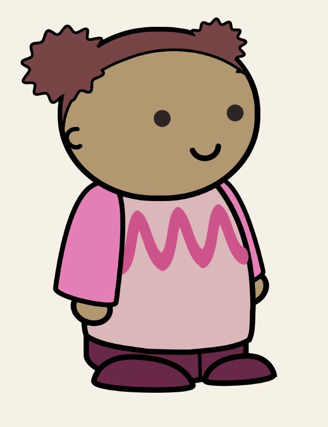

---
# Built from outline.md. Slide numbers in the notes follow the outline.
# The speaker notes hold my words from the outline and from the rehearsals of
# 24 and 26 November, as keywords in bold with the sentence behind them.
pagetitle: "Teaching Git, GitHub, and AI coding agents"
bibliography: references.bib
lang: en-GB
format:
  revealjs:
    theme: [default, deck.scss]
    width: 1600
    height: 900
    margin: 0.06
    controls: false
    progress: false
    slide-number: c/t
    menu: false
    hash: true
    transition: none
    embed-resources: true
    center: false
    include-in-header:
      - file: font-face.html
execute:
  echo: false
  warning: false
  message: false
---

```{r}
#| label: setup
library(ggplot2)
library(dplyr)
library(readr)

feedback <- read_csv(here::here("data", "feedback_items.csv"), show_col_types = FALSE)
survey <- read_csv(here::here("data", "survey_counts.csv"), show_col_types = FALSE)
persons <- read_csv(here::here("data", "commits_by_person.csv"), show_col_types = FALSE)

paper <- "#F6F1E7"
ink <- "#1A1714"
grey <- "#B9B2A6"
accent <- "#901C6C"
note_colours <- c("went well" = "#F2A04A", "can be improved" = "#C9A0DC")

theme_talk <- theme_minimal(base_size = 30, base_family = "Atkinson Hyperlegible Next") +
  theme(
    plot.background = element_rect(fill = paper, colour = NA),
    panel.background = element_rect(fill = paper, colour = NA),
    panel.grid = element_blank(),
    axis.title = element_blank(),
    axis.text = element_text(colour = ink),
    axis.text.x = element_blank(),
    legend.position = "top",
    legend.title = element_blank(),
    legend.justification = "left",
    text = element_text(colour = ink)
  )
```

## {.title-slide-own}

::: {.tt}
Teaching Git, GitHub, and [AI]{.ai} coding agents to researchers who do not come from IT
:::

::: {.ta}
Lars Schöbitz, Global Health Engineering, ETH Zurich

EnhanceR Symposium 2026, Paul Scherrer Institute, 30 November 2026
:::

::: {.notes}
**Slide 1, title.** On the screen before the talk.

- **Thanks** for the introduction.
- **The title:** the organisers added "AI" to it, and it fits the day.
- **Who I am:** Lars, Global Health Engineering, ETH Zurich.
:::

## Please stand up

::::: {.columns .standup}
::: {.column width="48%"}
::: {.fragment}
**Sit down** if you do not teach Git, GitHub or coding agents to researchers.
:::
:::

::: {.column width="48%"}
::: {.fragment}
**Sit down** if you have had no training in how adults learn.
:::
:::
:::::

::: {.notes}
**Slide 2, 1 minute.** Everyone up, then two clicks.

- **Ask:** please stand up.
- **CLICK. Sit down** if you do not teach Git, GitHub or coding agents to researchers.
- **CLICK. Sit down** if you have had no formal or semi-formal training in how adults learn.
- **Those still standing** teach and have had training in how adults learn. My talk is the argument that all of us should, especially when we work with novices in technical topics.

**If the room reacts differently:**

- **Nobody left standing:** "Nobody. That is why I am giving this talk."
- **Many left standing:** one voice with one sentence, then "thank you, please sit".
- **Nobody gets up within five seconds:** hands.
:::

## {.adm-slide}

::: {.adm}
No doctorate.

No qualification in statistics.

No computer science degree.

::: {.fragment .stay}
An environmental engineer who likes computers.
:::

::: {.fragment .stay}
Empathy, patience and persistence.
:::

::: {.fragment .stay}
Embedded data steward.
:::
:::

::: {.notes}
**Slide 3, who speaks. 1 minute.** Three clicks.

- **No doctorate, no statistics, no computer science degree.** It helps me when I teach novices technical topics such as Git and GitHub.
- **CLICK. Environmental engineer who likes computers.** If my sister had been given the computer at the age that I was, she would be standing here today.
- **CLICK. Empathy, patience and persistence.** These topics are hard, and people may have had bad experiences with technical topics. Persistence: I do not give up when someone does not like it on the first day.
- **CLICK. Embedded data steward:** I work inside one research group. My purpose is to support the group in learning technical topics and in its data management. I am not in a central unit and I am not a research IT expert.

**Optional, one sentence** on why this talk belongs to a day on AI: the fear that keeps people from Git is the same fear that keeps them from agents.
:::

## {.section-slide}

::: {.section-title}
How adults learn
:::

::: {.notes}
**Section slide.** No words. Take a breath, then click.
:::

## Where this comes from

- [Teaching Tech Together](https://teachtogether.tech/), Greg Wilson (2019), free to read
- The book is derived from [The Carpentries Instructor Training](https://carpentries.github.io/instructor-training/), the open route today
- My own route: the RStudio instructor certification in 2020, built by Greg Wilson on the same material

::: {.key}
Be honest with ourselves, be critical with ourselves, to improve our teaching.
:::

::: {.notes}
**Slide 4, 1 minute.**

- **The book:** everything I tell you today, my philosophy and my values, comes from Teaching Tech Together by Greg Wilson, 2019.
- **The training:** the book comes out of The Carpentries Instructor Training. It is open today, and one of our assistants has recently taken it. Two days of your time.
- **My route:** I took it in 2020 as the RStudio instructor certification, which Greg Wilson built on the same material.
- **What it teaches:** to be honest with ourselves and critical with ourselves, to improve our teaching for people who do not come from IT.

**Say** "co-founder of Software Carpentry", never "founder of the Carpentries".
:::

## The expert blind spot

::::: {.columns}
::: {.column .drawing width="58%"}
```{r}
#| label: drawing-blindspot
#| output: asis
cat("```{=html}", readLines(here::here("slides", "img", "drawing-blindspot.svg")), "```", sep = "\n")
```
:::

::: {.column .side-key width="41%"}
Experts design their teaching from their own mental model.

Novices receive too many uncertainties.
:::
:::::

::: {.source}
Definition: @wilson2019 [chaps. 2 and 3]. The error message example and the drawing are mine.
:::

::: {.notes}
**Slide 6, 50 seconds.**

- **Definition:** teaching material designed by experts follows the mental model of an expert. A novice does not have that model yet.
- **What novices feel:** we assume things they do not have. They feel lost, their questions stay unanswered, and they receive too many uncertainties to feel comfortable.
- **The error message:** fixing an error is a normal step for an expert. A novice reads it as: it is me, I did something wrong.
- **One of my own, from last week:** in a room of data professionals I never said what version control is. More of these at the end.
:::

## No gene for coding

::::: {.columns}
::: {.column width="36%"}
- 778 computer science classes
- **5.8%** showed two groups
- That is what chance alone gives
:::

::: {.column .drawing width="63%"}
```{r}
#| label: drawing-humps
#| output: asis
cat("```{=html}", readLines(here::here("slides", "img", "drawing-humps.svg")), "```", sep = "\n")
```
:::
:::::

::: {.source}
@patitsas2016, cited in @wilson2019 [chap. 10, Motivation and Demotivation]
:::

::: {.notes}
**Slide 7, 40 seconds.** One study only. The drawing is a sketch without data.

- **The belief:** some people believe there is a gene or a talent for coding. Some can do it, others cannot.
- **The study:** one study looked at 778 computer science classes at one university.
- **What the belief predicts:** two groups in the grades, one bump at the low grades and one at the high grades.
- **What it found:** 5.8% of the classes showed two groups, about one class in twenty. That is what the test flags by chance alone.
- **So:** the evidence does not support it. What does decide whether adults learn has a lot to do with motivation.

**Facts to keep straight:**

- **One study, one university, 778 classes.** Never "a few studies", never "about 800".
- **"The evidence does not support it",** never "disproven".
- **5.8% is the false alarm rate of the test.** No "standard error", no "uncertainties".

**Out since 26 November:** the second part of the study, on what teachers see in unclear grade charts. Nobody gave grades in it.
:::

## What motivates adults to learn

::::: {.columns}
::: {.column width="26%"}
{fig-alt="A drawn figure of a child with two hair buns, smiling."}
:::

::: {.column width="73%"}
- **Self-efficacy:** I am in control of my own life.
- **Utility:** This will help me meet my goals.
- **Community:** People I know are learning this with me.

::: {.fragment .key}
The pre-work gives everyone an early win.
:::
:::
:::::

::: {.source}
Figure and wording: Greg Wilson, slides on motivation for Teaching Tech Together, CC BY-SA. Art from openclipart.org.
:::

::: {.notes}
**Slide 8, 60 seconds.**

- **Self-efficacy:** people want to be in control of their own life. "You must learn this software" does not help. I can only make offers, and ask as little as possible with each one.
- **Utility:** it has to help them reach their goals. Your goals as a software engineer are reproducibility, version control, collaboration. Theirs differ. So I help them answer: how does Git help me?
- **Community:** learning is a social process. We need to be in a room, exchange and learn from peers.
- **CLICK. Pre-work:** people arrive with a working setup and have explored the topics in their own time. The first hour repeats it, so nothing in that hour is new, and there is room for explanations and questions. That is an early win. If I lose people in the first hour, they are gone.

**Do not say:** anything on online courses, videos or MOOCs. I have no source for it.

**Say** "early win" once.
:::

## What takes motivation away

::::: {.columns}
::: {.column width="73%"}
- **Unpredictability:** what I do does not seem to affect the outcome.
- **Unfairness:** the teacher plays favourites.
- **Indifference:** nobody cares.

::: {.fragment .key}
20 seconds, just with yourself: what might you have done in class that took the motivation away?
:::
:::

::: {.column width="26%"}
{fig-alt="The same drawn figure, frowning."}
:::
:::::

::: {.source}
Figure and wording: Greg Wilson, slides on motivation for Teaching Tech Together, CC BY-SA. Art from openclipart.org.
:::

::: {.notes}
**Slide 9, 60 seconds with the silence.**

- **Unpredictability:** I tell someone to take a step, and what they see differs from what I told them to expect.
- **Unfairness:** playing favourites in the room. We are human and we have favourites. Showing it takes the motivation of everyone else.
- **Indifference:** the feeling that nobody cares whether I keep up. What I do against it: I follow up with people in the room, after a workshop, and especially between two workshops.
- **CLICK. The 20 seconds,** said once: "20 seconds, just with yourself: what might you have done in class that took the motivation away? I will not ask you to share it." Then count to 20 in silence.
- **After:** thank you. Maybe you have something to act on in your next class.
:::

## {.words-slide}

::::: {.columns}
::: {.column width="62%"}
::: {.words}
just

quickly

easily
:::
:::

::: {.column width="37%"}
{fig-alt="A drawn figure of a child with two hair buns, frowning."}
:::
:::::

::: {.fragment .key}
Have you ever filmed your own workshop?
:::

::: {.source}
Figure: Greg Wilson, slides on motivation for Teaching Tech Together, CC BY-SA. Art from openclipart.org.
:::

::: {.notes}
**Slide 5, 50 seconds.** Follows the 20 seconds.

- **Transition:** something concrete to act on is words like these.
- **When they come:** when we teach, and especially when we are nervous, we say "you just click here" and "we quickly do this". They come out unnoticed.
- **What a novice hears:** nothing is worse for a novice than hearing that a step costs nothing while they feel they did not get it. They hear: it is me.
- **CLICK. Film yourself:** record a workshop, watch it, be honest, and count how often you use these words.

**If one slips out here:** name it ("that is me doing it right now"). It worked in the rehearsal of 26 November.

**Placeholder:** the figure stands in for a photo of someone who looks demotivated.
:::

## {.section-slide}

::: {.section-title}
Embedded in a research group
:::

::: {.notes}
**Section slide.** No words. Take a breath, then click.
:::

## Embedded

::::: {.columns}
::: {.column .big-list width="30%"}
::: {.fragment .stay}
- **Every day**
:::

::: {.fragment .stay}
- **Informal meetings**
:::

::: {.fragment .stay}
- **Learner persona**
:::

::: {.fragment .stay}
- **What it costs**
:::
:::

::: {.column .drawing .drawing-big width="69%"}
```{r}
#| label: drawing-embedded
#| output: asis
cat("```{=html}", readLines(here::here("slides", "img", "drawing-embedded.svg")), "```", sep = "\n")
```
:::
:::::

::: {.notes}
**Slide 10b, 2 minutes.** Four clicks, keywords only.

- **CLICK. Every day:** I have been in the group for five years, as a data steward who also takes care of IT and open science. On every day in the office I go into everyone's office in the morning and greet them, and I try to do the same when I leave.
- **CLICK. Informal meetings:** these are the moments in which I hear what is hard for people right now: AI, data, publications. I cannot hold a weekly meeting with everyone. Data stewards often say that all their time goes into meetings and emails and none is left to teach. Informal meetings give me the same information, when I do them with intent and act on what I hear.
- **CLICK. Learner persona:** this is why someone like me is well placed inside the group. I know the people, their competencies, their needs and their fears. That is harder from a central unit. I am not arguing against central units. I am arguing for data stewards inside the groups who coordinate with the central units that provide the services.
- **CLICK. What it costs:** one permanent position in the group, in place of another doctoral student.

**Check before I say it in public:** the percentage of the position, the job class and the amount in francs. I said them in both timed runs.
:::

## {.section-slide}

::: {.section-title}
Git, GitHub and agents in the group: the teaching and the evidence
:::

::: {.notes}
**Section slide.** No words. Take a breath, then click.
:::

## The tools and the teaching come from inside the group

::: {.years}
- [2021 to 2025]{.yr} [Git taught one to one and in R courses]{.what}
- [2025]{.yr} [Claude Code introduced in the group]{.what}
- [2026]{.yr} [[**Git for Scientists**](https://gitforsci-ghe.github.io/website/), a workshop for the foundation]{.what}
- [2026]{.yr} [[**Agents for Scientists**](https://agentsforsci-ghe.github.io/website/), a workshop on coding agents]{.what}
- [2027]{.yr} [[**FAIR by Doing**](https://github.com/Global-Health-Engineering/fair-training), proposed for 15 ETH researchers]{.what}
:::

::: {.notes}
**45 seconds.** The slide from my talk at the Research Data Conference.

- **2021 to 2025:** the tools and the teaching come from inside the group. I taught Git one to one, and in the R course for bachelor, master and doctoral students.
- **2025:** early in the year I introduced Claude Code. I wanted everyone to know what this tool can do.
- **A year later:** I saw that the foundation comes first. Git and GitHub are what makes working with a coding agent safer.
- **2026:** so now there are two workshops, Git for Scientists and Agents for Scientists.
- **2027:** both are part of a twelve month programme, FAIR by Doing, proposed for 15 ETH researchers and under review. One clause, no more.
:::

## Commits by group member: each bar is one person

```{r}
#| label: plot-commits-by-person
#| fig-width: 15
#| fig-height: 6.2
bars <- persons |>
  mutate(
    who = case_match(
      workshop,
      "trainer" ~ "me",
      "participant" ~ "trained in a workshop",
      "none" ~ "not trained"
    ),
    # Height on a square root scale; the solid part is the share of
    # commits written with an agent.
    height = sqrt(commits),
    solid = if_else(commits > 0, height * assisted / commits, 0)
  )

label_size <- 9
deck_font <- "Atkinson Hyperlegible Next"

commit_lines <- tibble(commits = c(100, 500, 1000), y = sqrt(commits))

ggplot(bars, aes(x = rank, fill = who)) +
  geom_hline(data = commit_lines, aes(yintercept = y), colour = grey, linewidth = 0.6, linetype = "dashed") +
  geom_text(
    data = commit_lines, aes(x = 17.6, y = y, label = paste(format(commits, big.mark = ","), "commits")),
    inherit.aes = FALSE, hjust = 1, vjust = -0.4, size = 7.5, colour = "#4A453E", family = deck_font
  ) +
  geom_col(aes(y = height), width = 0.8, alpha = 0.3) +
  geom_col(aes(y = solid), width = 0.8) +
  geom_point(
    data = filter(bars, workshop == "participant", commits == 0),
    aes(y = 0), colour = accent, size = 9
  ) +
  annotate("text", x = 1.55, y = 34, label = "me", hjust = 0, size = label_size, colour = ink, fontface = "bold", family = deck_font) +
  annotate("text", x = 2.55, y = 20.4, label = "trained in a workshop", hjust = 0, size = label_size, colour = accent, fontface = "bold", family = deck_font) +
  annotate("text", x = 7.6, y = 8.5, label = "not trained", hjust = 0, size = label_size, colour = "#4A453E", fontface = "bold", family = deck_font) +
  annotate("text", x = 5, y = 27, label = "solid part of a bar:\ncommits written with an agent", hjust = 0, size = label_size, colour = ink, lineheight = 0.9, family = deck_font) +
  annotate(
    "text", x = 14, y = 5.5, label = "7 of 14 trained:\nno commit on GitHub",
    size = label_size, colour = accent, lineheight = 0.9, fontface = "bold", family = deck_font
  ) +
  scale_fill_manual(values = c("me" = ink, "trained in a workshop" = accent, "not trained" = "#8A8378"), guide = "none") +
  scale_y_continuous(expand = expansion(mult = c(0.02, 0.05))) +
  coord_cartesian(clip = "off") +
  theme_talk +
  theme(axis.text.y = element_blank())
```

::: {.source}
Commits by the 17 group members on GitHub, November 2025 to October 2026, students not counted. Data: ghedata, snapshot of 11 November 2026. The scale is compressed towards the top, so that a bar of 1 commit and a bar of 1,247 commits fit into one chart.
:::

::: {.notes}
**Slide 11, 70 seconds.** The group has seen this chart.

- **What it shows:** commits by group member over twelve months. Each bar is one person.
- **Me:** the first bar.
- **Purple:** the 14 people who took one of my workshops. Two people in the group are not trained.
- **The scale:** the dashed lines mark 100, 500 and 1,000 commits. They are not evenly spaced: the scale is compressed towards the top, because my bar is ten times the others.
- **Solid part of a bar:** commits written with an agent. For some people that is every commit, for me about 80%.
- **The 7 dots:** trained, and no commit on GitHub. I found this when I made the slide. Now I can ask these seven what holds them back.

**Numbers:** 17 group members over the twelve months, 15 in the group today, 14 of the 17 trained. Students are not in the chart.

**No detour** into how AI use is declared. That comes later, with this deck as the case.

**Open:** look at the 7 before the talk.
:::

## An open question

```{r}
#| label: assisted-share
share <- persons |>
  group_by(workshop) |>
  summarise(commits = sum(commits), assisted = sum(assisted))

pct <- function(w) round(100 * share$assisted[share$workshop == w] / share$commits[share$workshop == w])
n_of <- function(w, col) format(share[[col]][share$workshop == w], big.mark = ",")
```

::::: {.columns}
::: {.column width="50%"}
::: {.words}
7 of 14
:::

people **trained in a workshop** have commits on GitHub
:::

::: {.column width="50%"}
::: {.words .in-accent}
`r pct("participant")`%
:::

of their commits are written with an agent
:::
:::::

::: {.key}
What does a novice learn about Git when the agent writes the commit?
:::

::: {.fragment}
I have the data and no answer. If you study how people learn, I would like to find out with you.
:::

::: {.source}
`r n_of("participant", "assisted")` of `r n_of("participant", "commits")` commits by the 14 trained people. Same data as the chart before.
:::

::: {.notes}
**Slide 13, 45 seconds.**

- **The numbers:** half of the trained people have commits on GitHub, and they write most of them with an agent.
- **The question:** what does a novice still learn about Git when the agent writes the commands?
- **CLICK. The invitation:** I have the data and no answer. I can show who was trained, who was a novice, and how they work with agents. This is partly why I am here: if you study how people learn, I would like to find you.

**Left out:** growth mindset. The book itself says it may have been oversold.
:::

## Git for Scientists: teaching the need to know

::: {.need}
- Save a set of changes with a message [(a commit)]{.term}
- Read the changes between two versions of a file [(a diff)]{.term}
- Experiment safely [(a branch)]{.term}
- Review what has gone into a set of changes [(a pull request)]{.term}
- Know what should never enter a repository, or an AI tool [(data security)]{.term}
:::

::: {.notes}
**40 seconds.**

- **The minimum:** I teach on a need to know basis. Nobody is taught in the terminal. We use desktop apps: GitHub Desktop, RStudio, VS Code.
- **The four steps:** make a commit, see what changed in a file, work on a branch, bring the branch back through a pull request.
- **Data security:** what never goes into a repository or into an AI tool.
:::

## Agents for Scientists: handing the need to know over

::: {.need}
- **The agent does the mechanics:** commits, branches, pull requests
- **Work safely:** Git lets you revert
- **Track AI use:** the prompt is kept with its change
:::

::: {.key}
So that we can still prove what is human.
:::

::: {.notes}
**45 seconds.**

- **Once by hand:** people do each step once themselves, through a graphical interface.
- **Then they hand over:** researchers do not want to make commits, they want to do their research. So they say to the agent: I think this needs a commit, do you agree? And the agent commits.
- **They stay in control:** they still review what changed, and they review the pull request.
- **Why:** the mechanical work goes to the agent and the record stays. We track what the agent did and what the person did, so that we can declare both. The next slide shows that record.
:::

## One case: this deck

::::: {.columns}
::: {.column width="33%"}
### 1. My words

`outline.md`, commit `9434179`: the talk in my own words
:::

::: {.column width="33%"}
### 2. The agent's commit

`d2d6cf1`: "rebuild the deck from the outline", with the line `Co-Authored-By: Claude`
:::

::: {.column width="33%"}
### 3. The change

419 lines added, 76 removed, in 7 files. Each one can be read and taken back.
:::
:::::

::: {.key}
One history shows what is mine and what the agent wrote. That is what we declare in a publication.
:::

::: {.source}
<https://github.com/Global-Health-Engineering/talk-enhancer>
:::

::: {.notes}
**Slide 15b, 45 seconds.** It only works as the proof of the slide before: we track AI use and human contribution to be able to declare both, especially in future publications.

- **Link to the slide before:** this is what that record looks like. This deck is the case.
- **1. My words:** I wrote the talk as an outline in my own words and committed it.
- **2. The agent's commit:** I asked the agent to rebuild the deck from the outline. Its commit carries the line "Co-Authored-By: Claude".
- **3. The change:** 419 lines added, 76 removed, in 7 files. I can read each one and take it back.
- **The point:** I know which part is mine and which part the agent wrote. That is what I need to declare AI use in a publication, and the history gives it to me.
:::

## {.section-slide}

::: {.section-title}
Ask the learners
:::

::: {.notes}
**Section slide.** No words. Take a breath, then click.
:::

## Research Data Conference 2026: experts as learners

::: {.facts}
20 November 2026, Bern · two hours · about 30 data professionals
:::

::::: {.steps}
::: {.step}
[Before]{.when}

Pre-work at home

[some completed it in time, some did not]{.small}
:::

::: {.step}
[Hour 1]{.when}

The room takes the **learner seat**
:::

::: {.step}
[Hour 2]{.when}

The room takes the **educator seat**

[feedback on four flipcharts]{.small}
:::
:::::

::: {.notes}
**Slide 17, 40 seconds.**

- **Evaluation surveys:** I do not like them. Everything comes back as 8 or 9 out of 10, which shows me nothing, and people do not like filling them in.
- **What I did:** last week at the Research Data Conference in Bern I taught the first hour of the four hour Git for Scientists workshop to about 30 data professionals.
- **Hour 1:** the room took the learner seat.
- **Hour 2:** the room took the educator seat and gave me feedback on flipcharts.
:::

## 14 of 27 were new to Git or used it now and then

```{r}
#| label: plot-git-experience
#| fig-width: 15
#| fig-height: 6
survey |>
  filter(question == "git_experience") |>
  mutate(answer = factor(answer, levels = rev(c("never", "now and then", "regularly", "extensively")))) |>
  ggplot(aes(x = n, y = answer, fill = answer %in% c("never", "now and then"))) +
  geom_col(width = 0.7) +
  geom_text(aes(label = n), hjust = -0.4, size = 11, colour = ink, family = "Atkinson Hyperlegible Next") +
  scale_fill_manual(values = c("TRUE" = accent, "FALSE" = grey), guide = "none") +
  scale_x_continuous(expand = expansion(mult = c(0, 0.12))) +
  theme_talk
```

::: {.source}
"How much have you used Git?", 27 answers in the pre-course survey
:::

::: {.notes}
**Slide 18, 20 seconds.**

- **Who was in the room:** 27 answered the survey before the course. 14 of them were new to Git or used it now and then.
- **Why it was a good room:** novices and people who use Git extensively, side by side.

**Say** "27 answered the survey". The slide before says "about 30".

**Background:** 10 data stewards, 5 researchers, 2 librarians, 10 other roles. 16 teach Git or plan to.
:::

## A rubric for feedback {.rubric-slide}

```{r}
#| label: note-counts
note_counts <- feedback |>
  filter(source == "post_it") |>
  count(category, valence)

n_notes <- function(cat, val) {
  note_counts$n[note_counts$category == cat & note_counts$valence == val]
}
```

:::::::::::: {.rubric}
::: {.rh}
:::

::: {.rh}
Preparation
:::

::: {.rh}
Interaction
:::

::: {.rh}
Presentation
:::

::: {.rh}
Content
:::

::: {.rl .well}
Went well
:::

:::: {.rc}
[`r n_notes("preparation", "well")`]{.cnt}

::: {.fragment .paste .postit .well style="--r: -3deg;" data-fragment-index="5"}
Homework paid off :)
:::
::::

:::: {.rc}
[`r n_notes("interaction", "well")`]{.cnt}

::: {.fragment .paste .postit .well .long style="--r: 2deg;" data-fragment-index="6"}
Great communication and combo of "My turn" & "your turn"
:::
::::

:::: {.rc}
[`r n_notes("presentation", "well")`]{.cnt}

::: {.fragment .paste .postit .well style="--r: 3deg;" data-fragment-index="7"}
Calm, clear + kind teaching style
:::
::::

:::: {.rc}
[`r n_notes("content", "well")`]{.cnt}

::: {.fragment .paste .postit .well style="--r: 2deg;" data-fragment-index="8"}
I am a complete beginner and I'm starting to understand!
:::
::::

::: {.rl .improve}
Can be improved
:::

:::: {.rc}
[`r n_notes("preparation", "not_well")`]{.cnt}

::: {.fragment .paste .postit .improve style="--r: 2deg;" data-fragment-index="1"}
I didn't catch in the emails that more steps had been added.
:::
::::

:::: {.rc}
[`r n_notes("interaction", "not_well")`]{.cnt}

::: {.fragment .paste .postit .improve style="--r: -2deg;" data-fragment-index="2"}
Question invitations could be even clearer for hesitant people
:::
::::

:::: {.rc}
[`r n_notes("presentation", "not_well")`]{.cnt}

::: {.fragment .paste .postit .improve .long style="--r: 3deg;" data-fragment-index="3"}
Clearer display of window switching may improve a sense of content cohesion.
:::
::::

:::: {.rc}
[`r n_notes("content", "not_well")`]{.cnt}

::: {.fragment .paste .postit .improve .long style="--r: -3deg;" data-fragment-index="4"}
Missed some theoretical concepts on Git and Git vs. GitHub vs. GitLab
:::
::::
::::::::::::

::: {.source}
Four flipcharts, two colours of post-it notes, 65 notes from the room, 8 of them here. All notes: `data/feedback_items.csv` in the repository of this talk. Rubric after @wilson2019 [chap. 8] and his slides on feedback; the column Preparation is mine.
:::

::: {.notes}
**Slide 20, 2 minutes.** Eight clicks, one note per field, in the words of the room. The number in each field is the count of notes on that part of the flipchart.

- **The rubric:** four flipcharts. Preparation: before the course. Interaction: how I work with the room. Presentation: slides and website. Content: what I taught. One colour for what went well, one for what can be improved.
- **Before the first click:** I got 65 notes. You see one per field, eight in all. All of them are in the data of this talk.
- **Can be improved, four clicks:**
    - **Emails:** pre-work sent by email gets missed. Everyone gets too many emails.
    - **Questions:** hesitant people need to hear "now is the time to ask".
    - **Window switching:** show more clearly when I change from the slides to another window.
    - **Concepts:** I do not say what Git is, what GitHub is and how they differ. I am in two minds: explain first, or let novices use it first.
- **Went well, four clicks:**
    - **Homework paid off.**
    - **My turn, your turn.**
    - **Calm, clear and kind.**
    - **A complete beginner who starts to understand:** my favourite sentence. That is why I do this.
- **The failure of the day, one sentence:** the online board I had planned did not open in the room, so I set up flipcharts and post-its in the break, and that was the better round.

**Texts:** six were checked against the photos and the data on 25 November. Two were added on 26 November: "Great communication and combo of My turn & your turn" and "Clearer display of window switching may improve a sense of content cohesion." Both are whole notes. Capitals and one spelling are normalised.
:::

## A feedback form people fill in

::::: {.columns}
::: {.column width="30%"}
::: {.fragment .stay fragment-index=1}
- **Feedback form:** four areas, in words
:::

::: {.fragment .stay fragment-index=2}
- **Think, pair, share**
:::

::: {.fragment .stay fragment-index=3}
- **A number, if you need one:** 3 is "fully met"
:::

::: {.fragment .stay fragment-index=4}
- **The last 15 minutes**
:::
:::

::: {.column .drawing .drawing-big width="69%"}
```{r}
#| label: drawing-form
#| output: asis
cat("```{=html}", readLines(here::here("slides", "img", "drawing-form.svg")), "```", sep = "\n")
```
:::
:::::

::: {.notes}
**Slide 20b, 60 seconds.** Four clicks, each shows one part of the drawing. Change slides before I start on the form.

- **CLICK. Feedback form:** the link to the slide before. The same four areas as on the flipcharts, on one sheet: what went well and what can be improved, in words.
- **CLICK. Think, pair, share:** three minutes alone in quiet, then with a neighbour, then shared with the room.
- **CLICK. A number, if you need one:** "If you really need something quantitative, then consider a 5 point scale where 3 means expectations fully met. Otherwise you will get 90% 4s and 5s, even if it was bad."
- **CLICK. The last 15 minutes:** give people the last 15 minutes of the workshop for this. People like to give feedback.
- **Bridge to the close:** teach, collect the notes, turn them into data, change the material for the next time.

**The 90%** is my experience, I have no source for it. No comparison with online ratings.

**Check before I cite it:** Keeley et al. (2013) on the ceiling effect in evaluations of teaching. That 3 as "fully met" spreads the answers is practice, I found no study that shows it.
:::

## {.words-slide}

::: {.quote .large}
If you teach a technical tool, take an instructor training.
:::

- [The Carpentries Instructor Training](https://carpentries.github.io/instructor-training/): open, online
- The expert blind spot "can be overcome with training" [@wilson2019, chap. 3]

::: {.notes}
**Slide 22, the close. 1 minute.** It answers the second question of the opening.

- **Back to the opening:** at the start I asked who has had training in how adults learn.
- **Me:** I had none until 2020. I had the same expert blind spots and the same assumptions. Nothing of what I showed today would exist without that training.
- **The message:** if you teach a technical tool such as Git, GitHub or coding agents, take an instructor training. It is open to all of you.
- **The invitation:** if you study how people learn, or you wonder what it takes to place someone like me in a group, come and find me.
- **End:** thank you. Then questions.
:::

## Thank you

- Git for Scientists, open educational resource: <https://github.com/gitforsci>
- Slides and data of this talk: <https://github.com/Global-Health-Engineering/talk-enhancer>

::: {.ack}
**Cite as:** Schöbitz, L. (2026). Git for Scientists (v1.0.0). Zenodo. <https://doi.org/10.5281/zenodo.21703566>

**Funding and support:** [Swiss Reproducibility Network (SwissRN)](https://www.swissrn.org/contents/community/nodes/) local node at ETH Zurich & [Data Stewardship Network at ETH Zurich](https://library.ethz.ch/en/researching-and-publishing/data-management-and-policies/research-data-management/data-stewardship.html), funded by the [swissuniversities Open Science Programme](https://www.swissuniversities.ch/en/topics/open-science/open-science-programme) & [Global Health Engineering group at ETH Zurich](https://ghe.ethz.ch/)

**Licence:** this deck is shared under [CC BY 4.0](https://creativecommons.org/licenses/by/4.0/), except the two slides on motivation, which adapt slides by Greg Wilson and stay under CC BY-SA.

**Declaration of AI use:** I wrote the outline of this talk in my own words. Claude Code (Anthropic) built the slides, the charts and the drawings from it and revised them on my instructions. I reviewed every change. The full declaration: <https://github.com/Global-Health-Engineering/talk-enhancer/blob/main/AI-USE.md>

**References:**

::: {#refs}
:::
:::

::: {.notes}
**Slide 23.** On the screen during the questions.

**Declaration of AI use:** the short text on the slide and the full one in `AI-USE.md` were written on 26 November as proposals, mine to check. The link works once `dev` is merged into `main`.

**Open:** the second course site (Agents for Scientists).
:::

## {.section-slide}

::: {.section-title}
Additional slides
:::

::: {.notes}
Not part of the main run. For questions: five things I do, the folder as the unit of an output, GitHub activity as an indicator, GitHub and the ETH GitLab.
:::

## Five things I do

- **Words I leave out:** just, easily, quickly
- **Design for the novice:** every click is written down
- **Know the learners, then design:** survey first, content last
- **A learner account:** every demo runs with the rights of a learner
- **Type with the room,** mistakes included

::: {.notes}
Additional slide since 24 November.

Slide 10. Section 5, 2 minutes. So this is what we're doing in our group. I put a lot of emphasis on these aspects of learning. Here's how I teach.

Said: words I leave out (one glance back). Design for the novice, with an example: no gap between two steps, extra material marked as extra. Type with the room, with an example: participatory live coding, nothing is pasted, a mistake on my screen is a moment to take apart together.

On the slide, not said: know the learners, a learner account.
:::

## Why Git first, then agents

::::: {.columns}
::: {.column width="40%"}
- **The folder is the unit of an output**
- **Tasks are attached where they belong**
- **Version control keeps a prompt with its change**
:::

::: {.column .drawing width="59%"}
```{r}
#| label: drawing-folder
#| output: asis
cat("```{=html}", readLines(here::here("slides", "img", "drawing-folder.svg")), "```", sep = "\n")
```
:::
:::::

::: {.notes}
Additional slide since 24 November; in the main run the two slides on the need to know took its place.

Slide 15. And it moves people into a different mindset for project and folder organization, file management and so on. The folder as the unit of an output, a manuscript, a dataset, a piece of software, to which tasks, issues, are attached where they belong: in the issue tracker, not separate from the folder itself and buried in email, Asana, Todoist and the likes.

These elements are what opens people up to using agentic AI. The Git for Scientists work is agents work too. On 29 September the group took the second workshop, Agents for Scientists.

And the third point: when an agent changes files, version control keeps what was asked together with what changed. One case on the next slide.
:::

## GitHub activity as an indicator for competency?

::: {.quote}
"useful process indicators, but they are imperfect proxies for genuine competency"
:::

::: {.quote-source}
A reviewer of one of our proposals, April 2026, on commits and repository counts
:::

::: {.fragment .key}
They show who works with version control today. Everyone working with it is the aim.
:::

::: {.notes}
Additional slide since 24 November, for a question on what the commits chart can show.

Slide 12. Commits, pull requests, comments and so on may be imperfect proxies for competency or research quality, but they show who is actively working with version control systems today, and everyone working with them is the aim. Once we have everyone using the tools comfortably, we can increase our overall potential for collaborative work that leads to competency and quality.
:::

## Why GitHub and not the ETH GitLab, for now

- **A portfolio that stays:** people leave ETH with a public profile and their repositories
- **Open by default:** what can be public is public, and others outside ETH can work with us
- **One interface for everything:** workshops, repositories and agents are run through the GitHub API
- **A website from any repository:** GitHub Pages
- **It carries over:** the next employer most likely uses GitHub

::: {.key}
Not everything belongs there. The data management strategy will decide what goes to the ETH GitLab.
:::

::: {.notes}
Additional slide, for the question "Why not the GitLab of ETH?". From my notes of the practice run with the group on 16 November 2026.

It is a question I often get, and a good one. There is a lot that can and should be on GitLab. The reasons we are on GitHub so far:

One, my first motivation was and still is to give people something to show once they have left ETH: a public portfolio, a GitHub profile with their repositories. It fits the open by default part of our data, which can be public without restrictions.

Two, administration. I have always run my classes with the R package ghclass, which invites people to a GitHub organisation through the GitHub API. The API works extremely well, also with an agent. I do not know yet how I would do the same on the ETH GitLab servers.

Three, GitHub carries over. Whoever goes to work somewhere else can use what they learned.

Four, collaboration outside our group, the same reason we use Google Workspace.

Five, publishing. Any repository can become a website through GitHub Pages. CHECK before I say it: what the ETH GitLab offers for pages and continuous integration today.

The limit: for some of our work it should be GitLab, for data that is not public and has to stay on servers of ETH. ETH has clear classes (public, internal, confidential, strictly confidential), and our data management strategy will decide along those what goes where. The cost is one more platform and more to teach.
:::
