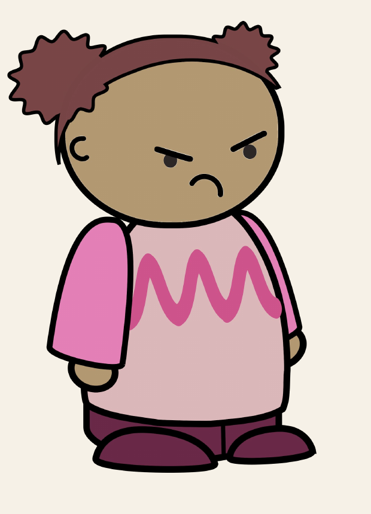

---
# Built from outline.md. Slide numbers in the notes follow the outline.
# The speaker notes hold my words from the outline.
pagetitle: "Teaching Git, GitHub, and AI coding agents"
lang: en-GB
format:
  revealjs:
    theme: [default, deck.scss]
    width: 1600
    height: 900
    margin: 0.06
    controls: false
    progress: false
    slide-number: c/t
    menu: false
    hash: true
    transition: none
    embed-resources: true
    center: false
    include-in-header:
      - file: font-face.html
execute:
  echo: false
  warning: false
  message: false
---

```{r}
#| label: setup
library(ggplot2)
library(dplyr)
library(readr)

feedback <- read_csv(here::here("data", "feedback_items.csv"), show_col_types = FALSE)
survey <- read_csv(here::here("data", "survey_counts.csv"), show_col_types = FALSE)
persons <- read_csv(here::here("data", "commits_by_person.csv"), show_col_types = FALSE)

paper <- "#F6F1E7"
ink <- "#1A1714"
grey <- "#B9B2A6"
accent <- "#901C6C"
note_colours <- c("went well" = "#F2A04A", "can be improved" = "#C9A0DC")

theme_talk <- theme_minimal(base_size = 30, base_family = "Atkinson Hyperlegible Next") +
  theme(
    plot.background = element_rect(fill = paper, colour = NA),
    panel.background = element_rect(fill = paper, colour = NA),
    panel.grid = element_blank(),
    axis.title = element_blank(),
    axis.text = element_text(colour = ink),
    axis.text.x = element_blank(),
    legend.position = "top",
    legend.title = element_blank(),
    legend.justification = "left",
    text = element_text(colour = ink)
  )
```

## {.title-slide-own}

::: {.tt}
Teaching Git, GitHub, and [AI]{.ai} coding agents to researchers who do not come from IT
:::

::: {.ta}
Lars Schöbitz, Global Health Engineering, ETH Zurich

EnhanceR Symposium 2026, Paul Scherrer Institute, 30 November 2026
:::

::: {.notes}
Slide 1. Section 1, 2 minutes with the next slide. On the screen before the talk.
:::

## Please stand up

::::: {.columns .standup}
::: {.column width="48%"}
::: {.fragment}
**Sit down** if you do not teach Git, GitHub or coding agents to researchers.
:::
:::

::: {.column width="48%"}
::: {.fragment}
**Sit down** if you have had no training in how adults learn.
:::
:::
:::::

::: {.notes}
Slide 2. Everyone up, please. Then two clicks: sit down if you do not teach; sit down if you have had no formal or semi-formal training in how adults learn.

Who in this room is teaching Git, GitHub or coding agents to scientists? Who in this room has had a formal or semi-formal education in teaching and learning, in how adults learn best?

Okay, I see quite a few people up here, that's great. I would love to hear what your education is.

RUN SHEET (proposal of the speaker coach): everyone stands, two questions, one voice with one sentence, then "thank you, please sit". If nobody is left standing: "Nobody. That is why I am giving this talk." If many: one voice only. If the room does not get up within five seconds: hands.
:::

## {.adm-slide}

::: {.adm}
No doctorate.

No qualification in statistics.

No computer science degree.

::: {.fragment .stay}
An environmental engineer who likes computers.
:::

::: {.fragment .stay}
Empathy, patience and persistence.
:::

::: {.fragment .stay}
Embedded data steward.
:::
:::

::: {.notes}
Slide 3, who speaks. Section 2, 2 minutes with the next slide. The slide from the RDC talk. I am an embedded data steward: I sit with the group, I am not in a central unit, and I am not a research IT expert.

PROPOSAL, one sentence on why this talk belongs to a day on AI: the fear that keeps people from Git is the same fear that keeps them from agents.
:::

## Where this comes from

- [Teaching Tech Together](https://teachtogether.tech/), Greg Wilson (2019), free to read
- The book is derived from [The Carpentries Instructor Training](https://carpentries.github.io/instructor-training/), the open route today
- My own route: the RStudio instructor certification in 2020, built by Greg Wilson on the same material

::: {.key}
Be honest with ourselves, be critical with ourselves, to improve our teaching.
:::

::: {.notes}
Slide 4. The one that I followed is Teaching Tech Together. Going through that program showed me many things that I have built into my teaching. Today I believe they are the reason why I have found a good way to teach technical concepts to people not from IT. That is largely who our learners are, or at least the learners that I choose to teach.

Crucial to all of this is that we find a way to evaluate ourselves, be honest to ourselves, be critical with ourselves to improve our teaching. Be open to applying new methods and realizing certain things that may feel uncomfortable.

Greg Wilson is the co-founder of Software Carpentry, which became part of The Carpentries. Say "co-founder of Software Carpentry"; in the timed run of 24 November I said "founder of the Carpentries".
:::

## The expert blind spot

::::: {.columns}
::: {.column .drawing width="58%"}
```{r}
#| label: drawing-blindspot
#| output: asis
cat("```{=html}", readLines(here::here("slides", "img", "drawing-blindspot.svg")), "```", sep = "\n")
```
:::

::: {.column .side-key width="41%"}
Experts design their teaching from their own mental model.

Novices receive too many uncertainties.
:::
:::::

::: {.source}
Definition: Greg Wilson, Teaching Tech Together (2019), chapters 2 and 3. The error message example and the drawing are mine.
:::

::: {.notes}
Slide 6. Experts can no longer imagine what it is like to not see the world that way. They often betray their blind spot by using the word "just". Novices do not yet have a usable mental model of the problem domain.

I check for my expert blind spots and always put myself into the learner's seat.

One of my own, from last week: in a room of 30 data professionals I never said what version control is. More of these at the end.
:::

## No gene for coding

::::: {.columns}
::: {.column width="36%"}
- 778 computer science classes
- **5.8%** showed two groups
- Teachers who believe in talent see two groups
:::

::: {.column .drawing width="63%"}
```{r}
#| label: drawing-humps
#| output: asis
cat("```{=html}", readLines(here::here("slides", "img", "drawing-humps.svg")), "```", sep = "\n")
```
:::
:::::

::: {.source}
Patitsas et al. (2016), cited in Greg Wilson, Teaching Tech Together (2019), chapter 10, Motivation and Demotivation
:::

::: {.notes}
Slide 7. The drawing is a sketch without data.

Script, 45 seconds: Some learners have been told that they are not made for technical topics, that there is something like a gene or a talent for coding. The evidence does not support it. One study looked at 778 computer science classes at one university. If there were two kinds of people, the grades would show two groups. About one class in twenty did, and that is what the test flags by chance alone. In a second part, 53 instructors looked at grade charts that were unclear. Those who believe in innate talent saw two groups more often. So the belief sits with the teacher. And what does decide whether adults learn has a lot to do with motivation.

Say "the evidence does not support it", never "disproven". Nobody gave grades in the second part, and 5.8% is the false alarm rate of the test (no "standard error").
:::

## What motivates adults to learn

::::: {.columns}
::: {.column width="26%"}
{fig-alt="A drawn figure of a child with two hair buns, smiling."}
:::

::: {.column width="73%"}
- **Self-efficacy:** I am in control of my own life.
- **Utility:** This will help me meet my goals.
- **Community:** People I know are learning this with me.

::: {.fragment .key}
The pre-work gives everyone an early win.
:::
:::
:::::

::: {.source}
Figure and wording: Greg Wilson, slides on motivation for Teaching Tech Together, CC BY-SA. Art from openclipart.org.
:::

::: {.notes}
Slide 8. Script, 60 seconds, from the timed run of 24 November.

Three things motivate adults to learn. Self-efficacy: I decide what I learn and when, and nobody forces me. Utility: it helps me reach my goals. Your goals differ from mine, so I have to know them. Community: people I know are learning this with me. Learning is a social process.

CLICK. This is why I give pre-work. Everyone does it at home, in their own time. In the first hour of the workshop we do it again together, and it works a second time. That is an early win for everyone in the room, also for those who needed three evenings for it.

Say "early win" once. No passage on online courses.
:::

## What takes motivation away

::::: {.columns}
::: {.column width="73%"}
- **Unpredictability:** what I do does not seem to affect the outcome.
- **Unfairness:** the teacher plays favourites.
- **Indifference:** nobody cares.

::: {.fragment .key}
20 seconds, just with yourself: what might you have done in class that took the motivation away?
:::
:::

::: {.column width="26%"}
{fig-alt="The same drawn figure, frowning."}
:::
:::::

::: {.source}
Figure and wording: Greg Wilson, slides on motivation for Teaching Tech Together, CC BY-SA. Art from openclipart.org.
:::

::: {.notes}
Slide 9. Script, 60 seconds with the silence.

Three things take motivation away. Unpredictability: I follow the steps on the page and something else happens on my screen, and nobody tells me why. Unfairness: the teacher talks with the advanced people and picks on the others. Indifference: nobody notices whether I keep up.

CLICK. 20 seconds, just with yourself: what might you have done in class that took the motivation away? I will not ask you to share it.

Count to 20 in silence. Then: thank you. Keep it with you for the rest of the day.
:::

## {.words-slide}

::::: {.columns}
::: {.column width="62%"}
::: {.words}
just

quickly

easily
:::
:::

::: {.column width="37%"}
{fig-alt="A drawn figure of a child with two hair buns, frowning."}
:::
:::::

::: {.fragment .key}
Have you ever filmed your own workshop?
:::

::: {.source}
Figure: Greg Wilson, slides on motivation for Teaching Tech Together, CC BY-SA. Art from openclipart.org.
:::

::: {.notes}
Moved behind the 20 seconds on 24 November. Transition: some of what takes motivation away sits in the words we use. Do not say "very easily" on this slide; it happened in the timed run.

Slide 5. Section 3, 3 minutes with the next two slides. PLACEHOLDER: the figure stands in for a photo of someone who looks highly demotivated.

How often in your teaching do you use the words just, quickly, easily? Have you ever observed yourself? Have you ever filmed your own workshop and then assessed how many times you use these words?

These are the types of words that we as educators, when we are speaking to our learners, they may slip out unnoticed. But what they can do in a learner is to put them into a seat where they don't believe in being able to learn these concepts themselves. They say that a step costs nothing. A learner who is stuck on it hears: it is me.
:::

## {.section-slide}

::: {.section-title}
What changes in the group
:::

::: {.notes}
Section slide, section 6 of the outline.
:::

## Embedded

::::: {.columns}
::: {.column .big-list width="30%"}
::: {.fragment .stay}
- **Every day**
:::

::: {.fragment .stay}
- **Informal meetings**
:::

::: {.fragment .stay}
- **Learner persona**
:::

::: {.fragment .stay}
- **What it costs**
:::
:::

::: {.column .drawing .drawing-big width="69%"}
```{r}
#| label: drawing-embedded
#| output: asis
cat("```{=html}", readLines(here::here("slides", "img", "drawing-embedded.svg")), "```", sep = "\n")
```
:::
:::::

::: {.notes}
Slide 10b. Four clicks, keywords only. 60 seconds.

Every day: I am an embedded data steward. I sit with the group and I see the people every day. Informal meetings: I do not host regular meetings on these topics. People come to me when they see the need, and then they share what they are working on. Learner persona: this is why I know my learners so well and can design the material for them. The survey is how I get to know a room of strangers. The daily contact is how I know the group.

What it costs: one permanent position in the group. The professor chose it over another postdoc. This is harder from a central unit, and the relationship with the learners matters there too.

CHECK before I say it in public: the percentage of the position and the name of the job class. In the timed run of 24 November I said both.

Left out on purpose: when I arrive and leave, and the passage on self-efficacy.
:::

## The tools and the teaching come from inside the group

::: {.years}
- [2021 to 2025]{.yr} [Git taught one to one and in R courses]{.what}
- [2025]{.yr} [Claude Code introduced in the group]{.what}
- [2026]{.yr} [[**Git for Scientists**](https://gitforsci-ghe.github.io/website/), a workshop for the foundation]{.what}
- [2026]{.yr} [[**Agents for Scientists**](https://agentsforsci-ghe.github.io/website/), a workshop on coding agents]{.what}
- [2027]{.yr} [[**FAIR by Doing**](https://github.com/Global-Health-Engineering/fair-training), proposed for 15 ETH researchers]{.what}
:::

::: {.notes}
Added 24 November, the slide from my talk at the Research Data Conference. 40 seconds.

I have been in the group for five years. In the first four I taught Git one to one, to those who were interested, and in my R courses. We have never applied force. It became more structured when we introduced Claude Code in 2025: working responsibly with an agent has Git and GitHub as its foundation. So this year the group took two workshops, Git for Scientists and then Agents for Scientists on 29 September. The next slide shows what that looks like in commits.

FAIR by Doing is proposed and not decided; one clause at most.
:::

## Commits by group member: each bar is one person

```{r}
#| label: plot-commits-by-person
#| fig-width: 15
#| fig-height: 6.2
bars <- persons |>
  mutate(
    who = case_match(
      workshop,
      "trainer" ~ "me",
      "participant" ~ "trained in a workshop",
      "none" ~ "not trained"
    ),
    # Height on a square root scale; the solid part is the share of
    # commits written with an agent.
    height = sqrt(commits),
    solid = if_else(commits > 0, height * assisted / commits, 0)
  )

label_size <- 9
deck_font <- "Atkinson Hyperlegible Next"

commit_lines <- tibble(commits = c(100, 500, 1000), y = sqrt(commits))

ggplot(bars, aes(x = rank, fill = who)) +
  geom_hline(data = commit_lines, aes(yintercept = y), colour = grey, linewidth = 0.6, linetype = "dashed") +
  geom_text(
    data = commit_lines, aes(x = 17.6, y = y, label = paste(format(commits, big.mark = ","), "commits")),
    inherit.aes = FALSE, hjust = 1, vjust = -0.4, size = 7.5, colour = "#4A453E", family = deck_font
  ) +
  geom_col(aes(y = height), width = 0.8, alpha = 0.3) +
  geom_col(aes(y = solid), width = 0.8) +
  geom_point(
    data = filter(bars, workshop == "participant", commits == 0),
    aes(y = 0), colour = accent, size = 9
  ) +
  annotate("text", x = 1.55, y = 34, label = "me", hjust = 0, size = label_size, colour = ink, fontface = "bold", family = deck_font) +
  annotate("text", x = 2.55, y = 20.4, label = "trained in a workshop", hjust = 0, size = label_size, colour = accent, fontface = "bold", family = deck_font) +
  annotate("text", x = 7.6, y = 8.5, label = "not trained", hjust = 0, size = label_size, colour = "#4A453E", fontface = "bold", family = deck_font) +
  annotate("text", x = 5, y = 27, label = "solid part of a bar:\ncommits written with an agent", hjust = 0, size = label_size, colour = ink, lineheight = 0.9, family = deck_font) +
  annotate(
    "text", x = 14, y = 5.5, label = "7 of 14 trained:\nno commit on GitHub",
    size = label_size, colour = accent, lineheight = 0.9, fontface = "bold", family = deck_font
  ) +
  scale_fill_manual(values = c("me" = ink, "trained in a workshop" = accent, "not trained" = "#8A8378"), guide = "none") +
  scale_y_continuous(expand = expansion(mult = c(0.02, 0.05))) +
  coord_cartesian(clip = "off") +
  theme_talk +
  theme(axis.text.y = element_blank())
```

::: {.source}
Commits by the 17 group members on GitHub, November 2025 to October 2026, students not counted. Data: ghedata, snapshot of 11 November 2026. The scale is compressed towards the top, so that a bar of 1 commit and a bar of 1,247 commits fit into one chart.
:::

::: {.notes}
Slide 11. Section 6, 4 minutes with the next slides. This is where the group stands with Git and GitHub, one year of commits. The group has seen this chart.

Each bar is one group member. The first bar is me. Purple marks the 14 people trained in our workshops, the two grey bars are group members who did not take one. Students are not part of this chart. The solid part of a bar is the share of commits written with an agent. The dashed lines mark 100, 500 and 1,000 commits. They are not evenly spaced: the scale is compressed towards the top (a square root scale), because my bar is ten times the others and they would vanish beside it.

The 7 dots at the end are trained people with no commit on GitHub. This is where my own method did not reach, and I do not know yet why. For some of them the Agents for Scientists workshop of 29 September was one month before the end of this window.

The number to say: 17 people were in the group over these twelve months, 15 are here today. 14 of the 17 were trained in a workshop.

OPEN: look at the 7 before the talk.
:::

## An open question

```{r}
#| label: assisted-share
share <- persons |>
  group_by(workshop) |>
  summarise(commits = sum(commits), assisted = sum(assisted))

pct <- function(w) round(100 * share$assisted[share$workshop == w] / share$commits[share$workshop == w])
n_of <- function(w, col) format(share[[col]][share$workshop == w], big.mark = ",")
```

::::: {.columns}
::: {.column width="50%"}
::: {.words}
7 of 14
:::

people **trained in a workshop** have commits on GitHub
:::

::: {.column width="50%"}
::: {.words .in-accent}
`r pct("participant")`%
:::

of their commits are written with an agent
:::
:::::

::: {.key}
What does a novice learn about Git when the agent writes the commit?
:::

::: {.fragment}
I have the data and no answer. If you study how people learn, I would like to find out with you.
:::

::: {.source}
`r n_of("participant", "assisted")` of `r n_of("participant", "commits")` commits by the 14 trained people. Same data as the chart before.
:::

::: {.notes}
Slide 13 (replaced on 24 November: the slide with fixed and growth mindset is out, the term stays in my words).

The aim of all of this is a growth mindset: "I can learn" in place of "I'm not good". Nobody is forced to learn a tool. I see it in the informal meetings, and I cannot show it with commits. The book I build on says itself that growth mindset may have been oversold.

What the data does show is this: half of the people trained in a workshop have commits on GitHub, and they write most of those commits with an agent. What does a novice learn about Git when the agent writes the commit? I have the data and no answer. If you study how people learn, I would like to find out with you.
:::

## Git for Scientists: teaching the need to know

::: {.need}
- Save a set of changes with a message [(a commit)]{.term}
- Read the changes between two versions of a file [(a diff)]{.term}
- Experiment safely [(a branch)]{.term}
- Review what has gone into a set of changes [(a pull request)]{.term}
- Know what should never enter a repository, or an AI tool [(data security)]{.term}
:::

::: {.notes}
Added 24 November, from my slides for the DSN Community Meeting 2026. 40 seconds.

We teach Git first, and then agents. What is left to teach once an agent takes the overhead fits into a day: make a commit and say what it holds, read a diff, experiment on a branch, review a pull request, and know what never enters a repository or an AI tool. The last one matters most. It has never been easier to paste personal data into a chat window.

This is the need to know. First we teach it.
:::

## Agents for Scientists: handing the need to know over

::: {.need}
- **The agent does the mechanics:** commits, branches, pull requests
- **Work safely:** Git lets you revert
- **Track AI use:** the prompt is kept with its change
:::

::: {.key}
So that we can still prove what is human.
:::

::: {.notes}
Added 24 November, from my slides for the DSN Community Meeting 2026. 40 seconds.

Then people hand the need to know over to the agent. The mechanical work goes to the agent: make a commit, open a pull request, work on this branch. Because the folder is under version control, every change of the agent can be read and taken back, which a chat window cannot do. And we keep the prompt together with its change, in a folder in the repository.

Why all of this: so that we can still prove what is human when we work with AI in research. Many people struggle with declaring how AI was used. With this record I can show it, and I can also show which part was mine. One case on the next slide.

Say the prompt folder once, here. The next slide shows it.
:::

## One case: this deck

::::: {.columns}
::: {.column width="33%"}
### 1. My words

`outline.md`, commit `9434179`: the talk in my own words
:::

::: {.column width="33%"}
### 2. The agent's commit

`d2d6cf1`: "rebuild the deck from the outline", with the line `Co-Authored-By: Claude`
:::

::: {.column width="33%"}
### 3. The change

419 lines added, 76 removed, in 7 files. Each one can be read and taken back.
:::
:::::

::: {.key}
What I asked for, who wrote it and what changed sit in one history.
:::

::: {.source}
<https://github.com/Global-Health-Engineering/talk-enhancer>
:::

::: {.notes}
Slide 15b (added 24 November), 45 seconds. It follows the slide on handing over, as the proof: this is what "the prompt is kept with its change" looks like. This deck is the case. I wrote the talk in my own words into one file and committed it. The agent rebuilt the slides from that file, and its commit carries a line that says so. The change is 419 lines in 7 files, and I can read every one of them and take any of them back. Without the folder and its history, I would have a chat window and a result.

CHECK: the two commits are public once dev is pushed.
:::

## {.section-slide}

::: {.section-title}
Ask the learners
:::

::: {.notes}
Section slide, section 7 of the outline.
:::

## Research Data Conference 2026: experts as learners

::: {.facts}
20 November 2026, Bern · two hours · about 30 data professionals
:::

::::: {.steps}
::: {.step}
[Before]{.when}

Pre-work at home

[some completed it in time, some did not]{.small}
:::

::: {.step}
[Hour 1]{.when}

The room takes the **learner seat**
:::

::: {.step}
[Hour 2]{.when}

The room takes the **educator seat**

[feedback on four flipcharts]{.small}
:::
:::::

::: {.notes}
Slide 17. Section 7, 3 minutes with the next four slides. I myself apply these principles in my own teaching. Last week I was at the Research Data Conference and I taught my first hour of my Git for Scientists workshop. All participants worked through the pre-work tasks. They completed them, some in time, some didn't.
:::

## 14 of 27 were new to Git or used it now and then

```{r}
#| label: plot-git-experience
#| fig-width: 15
#| fig-height: 6
survey |>
  filter(question == "git_experience") |>
  mutate(answer = factor(answer, levels = rev(c("never", "now and then", "regularly", "extensively")))) |>
  ggplot(aes(x = n, y = answer, fill = answer %in% c("never", "now and then"))) +
  geom_col(width = 0.7) +
  geom_text(aes(label = n), hjust = -0.4, size = 11, colour = ink, family = "Atkinson Hyperlegible Next") +
  scale_fill_manual(values = c("TRUE" = accent, "FALSE" = grey), guide = "none") +
  scale_x_continuous(expand = expansion(mult = c(0, 0.12))) +
  theme_talk
```

::: {.source}
"How much have you used Git?", 27 answers in the pre-course survey
:::

::: {.notes}
Slide 18. 27 answers in the pre-course survey: 10 data stewards, 5 researchers, 2 librarians, 10 other roles. 16 teach Git or plan to. Half are new to Git or use it now and then.
:::

## A rubric for feedback {.rubric-slide}

:::::::::::: {.rubric}
::: {.rh}
:::

::: {.rh}
Preparation
:::

::: {.rh}
Interaction
:::

::: {.rh}
Presentation
:::

::: {.rh}
Content
:::

::: {.rl .well}
Went well
:::

:::: {.rc}
::: {.fragment .paste .postit .well style="--r: -3deg;" data-fragment-index="4"}
Homework paid off :)
:::
::::

:::: {.rc}
::::

:::: {.rc}
::: {.fragment .paste .postit .well style="--r: 3deg;" data-fragment-index="5"}
Calm, clear + kind teaching style
:::
::::

:::: {.rc}
::: {.fragment .paste .postit .well style="--r: 2deg;" data-fragment-index="6"}
I am a complete beginner and I'm starting to understand!
:::
::::

::: {.rl .improve}
Can be improved
:::

:::: {.rc}
::: {.fragment .paste .postit .improve style="--r: 2deg;" data-fragment-index="1"}
Only one prep mail and one reminder.
:::
::::

:::: {.rc}
::: {.fragment .paste .postit .improve style="--r: -2deg;" data-fragment-index="2"}
Question invitations could be even clearer for hesitant people
:::
::::

:::: {.rc}
::::

:::: {.rc}
::: {.fragment .paste .postit .improve style="--r: -3deg;" data-fragment-index="3"}
Missed some theory: Git vs. GitHub vs. GitLab
:::
::::
::::::::::::

::: {.source}
Four flipcharts, two colours of post-it notes, 65 notes from the room. Rubric after Greg Wilson, Teaching Tech Together, chapter 8, and his slides on feedback; the column Preparation is mine.
:::

::: {.notes}
Slide 20. Four flipcharts in the room: preparation, interaction, presentation, content. One colour for what went well, one for what can be improved. This is the whole rubric.

One sentence on the failure of the day: the online board I had planned for this did not open in the room, so in the break I set up flipcharts and post-its, and that was the better round.

Six clicks, each pastes one note, in the words of the room. First three of my own blind spots: the emails before the day, the invitation to ask questions, the concepts before the tools. I teach against the blind spot and still have my own. Then three notes on what held: the pre-work paid off, the teaching style, and a complete beginner in a room of experts started to understand.

CHECK: the six texts against the photos of the notes. Four were shortened on 24 November.
:::

## A feedback form people fill in

::::: {.columns}
::: {.column width="30%"}
- **Short,** in the room
- **One scale:** 3 is "fully met"
- **The rest in words**
:::

::: {.column .drawing .drawing-big width="69%"}
```{r}
#| label: drawing-form
#| output: asis
cat("```{=html}", readLines(here::here("slides", "img", "drawing-form.svg")), "```", sep = "\n")
```
:::
:::::

::: {.notes}
Slide 20b (added 24 November). 45 seconds. Change slides before I start on the form.

A feedback form works when it is short and filled in in the room, in the last minutes of the workshop. Scales tell me little: on a five point scale most answers land on 4 and 5. The one scale I use tells people that 3 means "my expectations were fully met". I have six answers with it so far. The rest is feedback in words, along the four areas, with time to think alone, to pair and to share. The learners reflect on the workshop once more, and they practise giving feedback.

No comparison with online ratings and no percentage; I have no source for one.

CHECK before I cite it: Keeley et al. (2013) on the ceiling effect in evaluations of teaching. That 3 as "fully met" spreads the answers is practice, I found no study that shows it.
:::

## The loop

::: {.drawing .drawing-wide}
```{r}
#| label: drawing-loop
#| output: asis
cat("```{=html}", readLines(here::here("slides", "img", "drawing-loop.svg")), "```", sep = "\n")
```
:::

::: {.notes}
Slide 21. First cut if the talk runs long. Everything I've learned about this one week after my workshop itself, and how people can apply this to their own teaching, specifically through a feedback round.
:::

## {.words-slide}

::: {.quote .large}
If you teach a technical tool, take an instructor training.
:::

- [The Carpentries Instructor Training](https://carpentries.github.io/instructor-training/): open, online
- The expert blind spot "can be overcome with training" (Wilson 2019, chapter 3)

::: {.notes}
Slide 22. Section 8, 1 minute with the last slide. Close chosen on 24 November: take an instructor training. It answers the second question of the opening.

PROPOSAL for the closing words, mine to rewrite: At the start I asked who has had training in how adults learn. I had none until 2020. One course changed how I teach, and it is open to all of you. If you teach a technical tool, take an instructor training. And if you study how people learn, or you wonder what it takes to place someone like me in a group, come and find me.
:::

## Thank you

- Git for Scientists, open educational resource: <https://github.com/gitforsci>
- Slides and data of this talk: <https://github.com/Global-Health-Engineering/talk-enhancer>

::: {.ack}
**Cite as:** Schöbitz, L. (2026). Git for Scientists (v1.0.0). Zenodo. <https://doi.org/10.5281/zenodo.21703566>

**Funding and support:** [Swiss Reproducibility Network (SwissRN)](https://www.swissrn.org/contents/community/nodes/) local node at ETH Zurich & [Data Stewardship Network at ETH Zurich](https://library.ethz.ch/en/researching-and-publishing/data-management-and-policies/research-data-management/data-stewardship.html), funded by the [swissuniversities Open Science Programme](https://www.swissuniversities.ch/en/topics/open-science/open-science-programme) & [Global Health Engineering group at ETH Zurich](https://ghe.ethz.ch/)

**Licence:** this deck is shared under [CC BY 4.0](https://creativecommons.org/licenses/by/4.0/), except the two slides on motivation, which adapt slides by Greg Wilson and stay under CC BY-SA.

**Declaration of AI use:** to be written, as for the DSN talk.
:::

::: {.notes}
Slide 23. In the timed run I said that all use of AI is declared; the slide still says "to be written". Write it before 30 November or do not say it.

OPEN: the second course site (Agents for Scientists) and the declaration of AI use.
:::

## {.section-slide}

::: {.section-title}
Additional slides
:::

::: {.notes}
Not part of the main run. For questions: five things I do, the folder as the unit of an output, GitHub activity as an indicator, GitHub and the ETH GitLab.
:::

## Five things I do

- **Words I leave out:** just, easily, quickly
- **Design for the novice:** every click is written down
- **Know the learners, then design:** survey first, content last
- **A learner account:** every demo runs with the rights of a learner
- **Type with the room,** mistakes included

::: {.notes}
Additional slide since 24 November.

Slide 10. Section 5, 2 minutes. So this is what we're doing in our group. I put a lot of emphasis on these aspects of learning. Here's how I teach.

Said: words I leave out (one glance back). Design for the novice, with an example: no gap between two steps, extra material marked as extra. Type with the room, with an example: participatory live coding, nothing is pasted, a mistake on my screen is a moment to take apart together.

On the slide, not said: know the learners, a learner account.
:::

## Why Git first, then agents

::::: {.columns}
::: {.column width="40%"}
- **The folder is the unit of an output**
- **Tasks are attached where they belong**
- **Version control keeps a prompt with its change**
:::

::: {.column .drawing width="59%"}
```{r}
#| label: drawing-folder
#| output: asis
cat("```{=html}", readLines(here::here("slides", "img", "drawing-folder.svg")), "```", sep = "\n")
```
:::
:::::

::: {.notes}
Additional slide since 24 November; in the main run the two slides on the need to know took its place.

Slide 15. And it moves people into a different mindset for project and folder organization, file management and so on. The folder as the unit of an output, a manuscript, a dataset, a piece of software, to which tasks, issues, are attached where they belong: in the issue tracker, not separate from the folder itself and buried in email, Asana, Todoist and the likes.

These elements are what opens people up to using agentic AI. The Git for Scientists work is agents work too. On 29 September the group took the second workshop, Agents for Scientists.

And the third point: when an agent changes files, version control keeps what was asked together with what changed. One case on the next slide.
:::

## GitHub activity as an indicator for competency?

::: {.quote}
"useful process indicators, but they are imperfect proxies for genuine competency"
:::

::: {.quote-source}
A reviewer of one of our proposals, April 2026, on commits and repository counts
:::

::: {.fragment .key}
They show who works with version control today. Everyone working with it is the aim.
:::

::: {.notes}
Additional slide since 24 November, for a question on what the commits chart can show.

Slide 12. Commits, pull requests, comments and so on may be imperfect proxies for competency or research quality, but they show who is actively working with version control systems today, and everyone working with them is the aim. Once we have everyone using the tools comfortably, we can increase our overall potential for collaborative work that leads to competency and quality.
:::

## Why GitHub and not the ETH GitLab, for now

- **A portfolio that stays:** people leave ETH with a public profile and their repositories
- **Open by default:** what can be public is public, and others outside ETH can work with us
- **One interface for everything:** workshops, repositories and agents are run through the GitHub API
- **A website from any repository:** GitHub Pages
- **It carries over:** the next employer most likely uses GitHub

::: {.key}
Not everything belongs there. The data management strategy will decide what goes to the ETH GitLab.
:::

::: {.notes}
Additional slide, for the question "Why not the GitLab of ETH?". From my notes of the practice run with the group on 16 November 2026.

It is a question I often get, and a good one. There is a lot that can and should be on GitLab. The reasons we are on GitHub so far:

One, my first motivation was and still is to give people something to show once they have left ETH: a public portfolio, a GitHub profile with their repositories. It fits the open by default part of our data, which can be public without restrictions.

Two, administration. I have always run my classes with the R package ghclass, which invites people to a GitHub organisation through the GitHub API. The API works extremely well, also with an agent. I do not know yet how I would do the same on the ETH GitLab servers.

Three, GitHub carries over. Whoever goes to work somewhere else can use what they learned.

Four, collaboration outside our group, the same reason we use Google Workspace.

Five, publishing. Any repository can become a website through GitHub Pages. CHECK before I say it: what the ETH GitLab offers for pages and continuous integration today.

The limit: for some of our work it should be GitLab, for data that is not public and has to stay on servers of ETH. ETH has clear classes (public, internal, confidential, strictly confidential), and our data management strategy will decide along those what goes where. The cost is one more platform and more to teach.
:::
